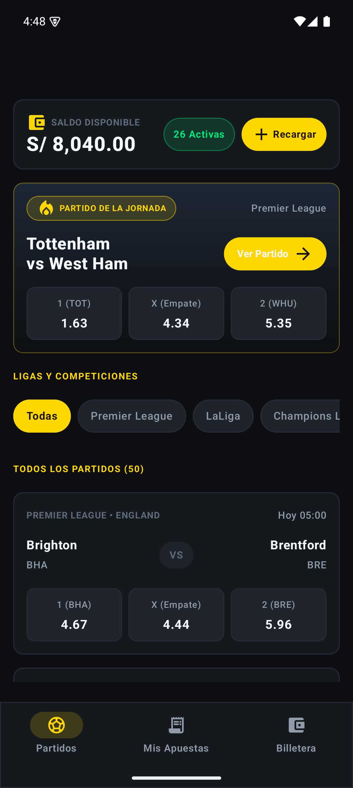
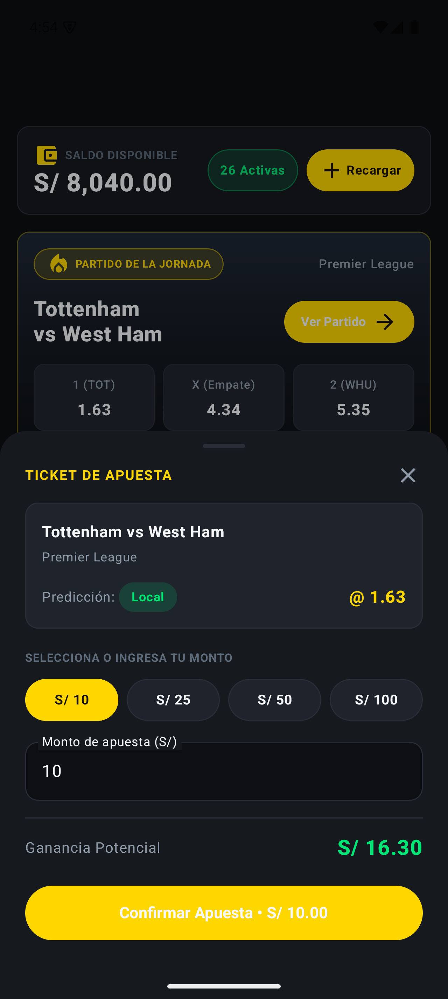
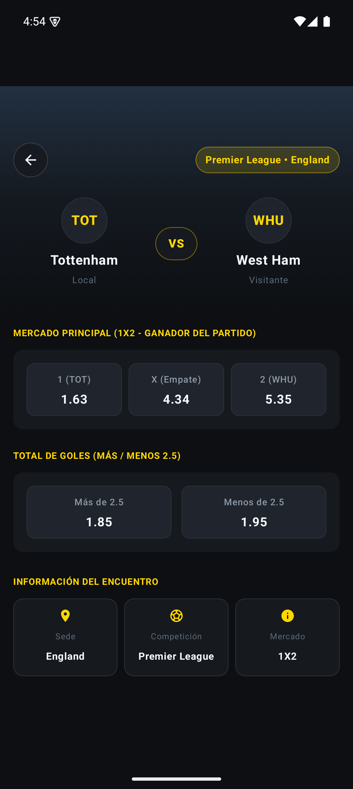
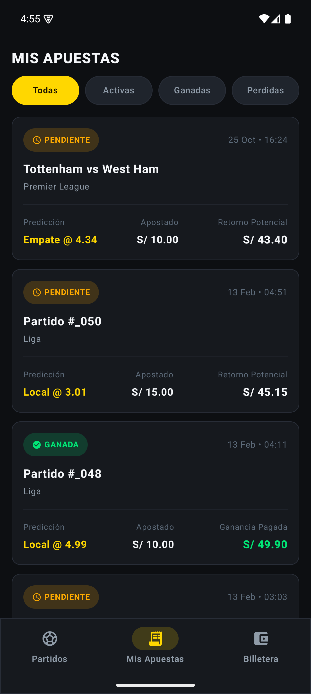
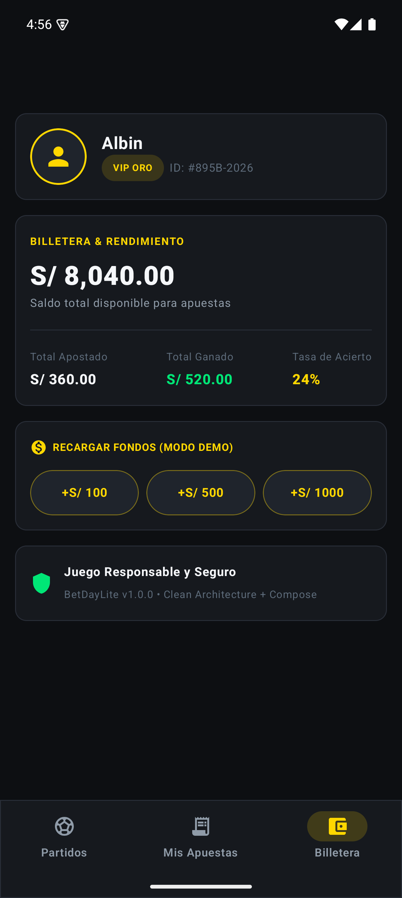

# ⚽ BetDay Lite — App de Apuestas Deportivas

[](https://developer.android.com)
[](https://kotlinlang.org)


**BetDay Lite** es una aplicación móvil nativa de alto rendimiento construida con **Kotlin**, **Jetpack Compose** y **Material 3**. Diseñada bajo los principios más rigurosos de **Clean Architecture** (Arquitectura Limpia) y separación por capas (`domain/entities`, `infrastructure`, `presentation`, `core`), ofrece una experiencia cinematográfica en modo oscuro inspirada en las principales plataformas de apuestas deportivas del mundo, con soporte nativo para **moneda en Soles peruanos (`S/`)** y gestión de cuenta del usuario **Albin**.

---

## 📸 Showcase de Pantallas en Dispositivo

Todas las capturas han sido obtenidas directamente desde un dispositivo Android (`Pixel 9 Pro` — API 35):

| 🏠 Home & Partidos | 🎟️ Modal BetSlip | 🔍 Detalle del Partido |
| :---: | :---: | :---: |
|  |  |  |
| *Hero banner con evento destacado, saldo en Soles (`S/ 8,040.00`), filtros de ligas y cuotas 1X2.* | *Bottom Sheet interactivo con chips rápidos (`S/ 10`, `S/ 25`, etc.) y cálculo de ganancia en vivo.* | *Header glassmorphic, mercados 1X2 y Más/Menos 2.5 goles, estadio y árbitro.* |

<br/>

| 📋 Mis Apuestas | 💳 Billetera & Perfil |
| :---: | :---: |
|  |  |
| *Historial de tickets activos y finalizados con estados (Pendiente, Ganada) y cuotas registradas.* | *Perfil de usuario **Albin** (VIP ORO), balance financiero, desglose de métricas y recarga de saldo.* |

---

## 🌟 Características Principales

- **🎨 Diseño Cinematográfico Dark Mode**:
  - Paleta *Obsidian Deep* (`#0D0F12`), acentos dorados *Championship Gold* (`#FFD700`) y acentos de ganancia *Neon Green* (`#00E676`).
  - Tarjetas elevadas con bordes pulidos de 16.dp y efectos glassmorphism.
- **⚡ Mercado de Apuestas 1X2 y Live Odds**:
  - Visualización de cuotas para Local (1), Empate (X) y Visita (2) en tiempo real.
  - Selección instantánea de cuotas con apertura automática del BetSlip.
- **🎟️ BetSlip Interactivo (Modal Bottom Sheet)**:
  - Botones de acceso rápido para montos frecuentes (`S/ 10`, `S/ 25`, `S/ 50`, `S/ 100`).
  - Cálculo instantáneo de ganancia potencial: `Ganancia = Monto × Cuota`.
  - Validación de saldo suficiente antes de confirmar la apuesta.
- **💰 Billetera y Perfil en Soles (`S/`)**:
  - Saldo en tiempo real persistido localmente.
  - Cuenta personalizada a nombre de **Albin** con insignia **VIP ORO**.
  - Simulación de recarga de saldo (`+ S/ 50`, `+ S/ 100`, `+ S/ 500`) con actualización inmediata en toda la app.
- **🗄️ Persistencia Local Offline-First (Room)**:
  - Base de datos local SQLite con Room (`BetDatabase`).
  - Historial completo de tickets de apuestas guardado de forma permanente.
- **🧭 Type-Safe Navigation Compose**:
  - Navegación moderna basada en rutas serializables (`@Serializable`) con Kotlin Serialization.

---

## 🏛️ Arquitectura del Software (Clean Architecture)

El proyecto sigue una separación estricta de responsabilidades en capas concéntricas e independientes:


```
app/src/main/java/com/albin/betdaylite/
├── core/
│   ├── constants/             # Constantes de negocio (moneda S/, límites, etc.)
│   ├── designsystem/          # Colores oscuros, tipografía Material 3, AppSpacing
│   └── navigation/            # Type-Safe Routes (@Serializable) y BetDayNavHost
├── domain/
│   ├── entities/              # Modelos puros de dominio (Match, Bet, Wallet, etc.)
│   ├── repository/            # Interfaces de repositorios
│   └── usecases/              # Reglas de negocio (GetMatchesUseCase, PlaceBetUseCase, etc.)
├── infrastructure/
│   ├── local/                 # Room Database, DAO y Entities (BetEntity, WalletEntity)
│   ├── remote/                # Retrofit API, DTOs y Mappers
│   └── repository/            # Implementaciones concretas de repositorios
├── presentation/
│   ├── home/                  # HomeScreen, HomeViewModel, HomeUiState, BetSlipBottomSheet
│   ├── detail/                # MatchDetailScreen, MatchDetailViewModel
│   ├── bets/                  # BetsHistoryScreen, BetsViewModel
│   ├── profile/               # ProfileScreen (Billetera Albin, recargas)
│   └── common/                # Componentes reutilizables (TopBars, BottomNav, OddsButton)
├── di/                        # Módulos de inyección de dependencias con Hilt
└── MainActivity.kt            # Entry point único con Compose Scaffold
```

---

## 🛠️ Stack Tecnológico

| Componente | Tecnología |
| :--- | :--- |
| **Lenguaje** | [Kotlin 2.0](https://kotlinlang.org/) |
| **UI Toolkit** | [Jetpack Compose](https://developer.android.com/jetpack/compose) + [Material Design 3](https://m3.material.io/) |
| **Navegación** | [Navigation Compose](https://developer.android.com/jetpack/compose/navigation) con Rutas Type-Safe |
| **Inyección de Dependencias** | [Dagger Hilt](https://developer.android.com/training/dependency-injection/hilt-android) |
| **Persistencia de Datos** | [Room Database](https://developer.android.com/training/data-storage/room) con SQLite |
| **Red & Serialización** | [Retrofit](https://square.github.io/retrofit/) 
| **Carga de Imágenes** | [Coil Compose](https://coil-kt.github.io/coil/compose/) con placeholders automáticos |
| **Testing** | [JUnit 4](https://junit.org/junit4/), [MockK](https://mockk.io/) & [Turbine](https://github.com/cashapp/turbine) |

---

## 🚀 Compilación y Ejecución

### Prerrequisitos
- **Android Studio Ladybug (2024.2+)** o superior.
- **JDK 17** o superior configurado.
- Dispositivo físico con depuración USB o emulador Android con **API 26+** (recomendado API 34 o 35).

### Clonar el Repositorio
```bash
git clone https://github.com/albinrk10/BetDayLitee.git
cd BetDayLitee
```

### Compilar e Instalar desde Terminal

**En Windows (PowerShell):**
```powershell
# 1. Compilar el APK en modo Debug
.\gradlew.bat assembleDebug

# 2. Instalar el APK en el dispositivo o emulador conectado
adb install -r app\build\outputs\apk\debug\app-debug.apk

# 3. Lanzar la aplicación
adb shell am start -n com.albin.betdaylite/.MainActivity
```

**En macOS / Linux:**
```bash
./gradlew assembleDebug
adb install -r app/build/outputs/apk/debug/app-debug.apk
adb shell am start -n com.albin.betdaylite/.MainActivity
```

---

## 🧪 Pruebas Automatizadas

El proyecto incluye pruebas unitarias exhaustivas para validar la lógica de negocio y los flujos de estado:

```powershell
# Ejecutar todas las pruebas unitarias
.\gradlew.bat test
```

### Casos de Prueba Clave:
- **`PlaceBetUseCaseTest`**:
  - ✅ Validación de saldo disponible en la billetera antes de permitir la apuesta.
  - ✅ Cálculo exacto de ganancia potencial (`stake * odds`).
  - ✅ Descuento atómico del saldo de la billetera y registro del ticket en el repositorio.
- **`HomeViewModelTest`**:
  - ✅ Carga exitosa de eventos deportivos y manejo de estados `Loading`, `Success` y `Error`.
  - ✅ Interacción y selección de cuotas para apertura reactiva del BetSlip.

---

## 👨‍💻 Autor

Desarrollado por **Albin**  
Repositorio: [https://github.com/albinrk10/BetDayLitee](https://github.com/albinrk10/BetDayLitee)
